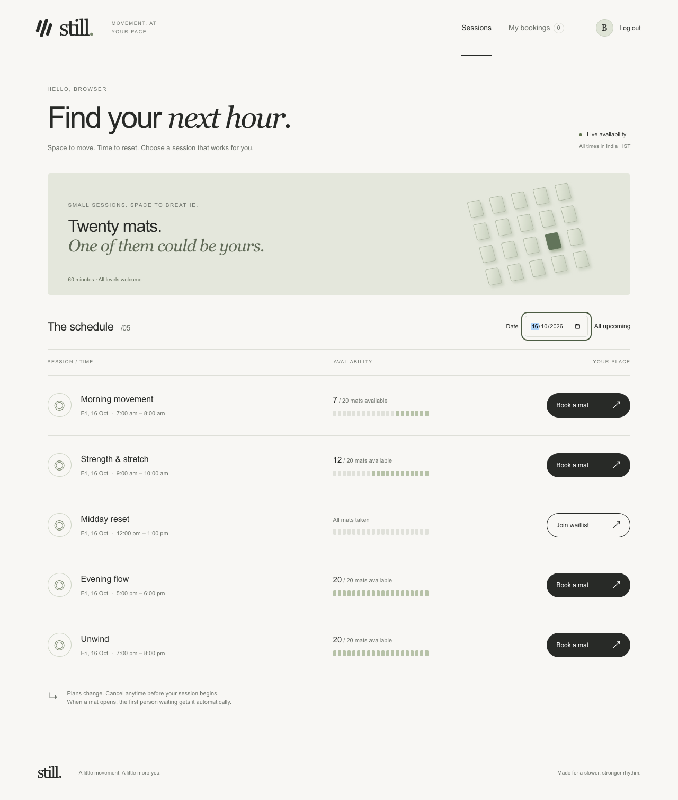

# Still — Gym Slot Booking

A minimal gym booking app for BYTE’s web development challenge. Members reserve one of twenty mats, join a fair waitlist, and show a short code at the door. Staff manage sessions and attendance.

**Task 2 repository:** https://github.com/iamtanish2618/still-gym



## Stack and data model (8 lines)

1. React + TypeScript frontend, with plain responsive CSS and protected hash routes.
2. Vinext serves the UI and a same-origin REST API on Cloudflare Workers.
3. Cloudflare D1 is a real SQLite database; Drizzle describes the five related tables.
4. `users` holds normalized unique emails, salted password hashes and database-assigned roles.
5. `sessions` has unique start timestamps and a CHECK constraint fixing capacity at 20.
6. `bookings` stores confirmation/waitlist/cancellation state, random code and attendance timestamp.
7. A partial unique index prevents duplicate active bookings; triggers guard capacity and promote FIFO atomically.
8. `tokens` stores SHA-256 digests of expiring opaque tokens; `rate_limits` limits authentication and check-in attempts.

## Quick start

Requires **Node.js 22.13+**, npm, and Git. Node 24 LTS is a sensible local choice. No Cloudflare account is needed for local development.

```sh
git clone https://github.com/iamtanish2618/still-gym.git
cd still-gym
npm ci
npm run build
npm run db:migrate
npm run db:seed
npm run dev
```

Open the local address printed by the server (normally `http://127.0.0.1:5173`). The backend and frontend share that origin. Migrate after the first build because the build writes Wrangler’s local configuration. `db:migrate` uses Wrangler's migration ledger and can be repeated; `db:seed` is for a fresh database and does not overwrite existing users. Local data persists in the ignored `.wrangler/state` folder across restarts.

The app needs no application signing secret: each login produces a cryptographically random token. `.env.example` documents the optional local seed-password override and one-time hosted setup secret. Never commit `.env`, `.dev.vars`, tokens, or database files. `.openai/hosting.json` contains a deployment identifier, not credentials.

## Demo accounts

| Role | Email | Password |
| --- | --- | --- |
| Admin | `admin@still.demo` | `StillDemo2026!` |
| Member | `aanya@still.demo` | `StillDemo2026!` |
| Member | `kabir@still.demo` | `StillDemo2026!` |
| Member in the full session | `member1@still.demo` | `StillDemo2026!` |

These are intentional public demo credentials, not production secrets. The seed creates 23 users, 26 sessions over several days, a full session, partially occupied sessions and one active session with Aanya booked for a check-in demonstration. Dates are relative to the time you seed. Admins are inserted directly into the database by the seed; registration always creates members and rejects a supplied role.

## Reviewer walkthrough

1. Log in as Aanya. Choose **All upcoming** or tomorrow’s date. Inspect available, booked and full sessions.
2. Join the full session’s waitlist. **My bookings** shows position 1 and no usable code yet.
3. In a separate browser/profile, log in as `member1@still.demo`, cancel that same session, and leave Aanya’s screen open.
4. Within three seconds Aanya is confirmed, receives a code and a promotion message. Nobody refreshes. The session still has twenty bookings.
5. Cancel Aanya’s future booking and rebook to verify the active-record constraint allows a new booking after cancellation.
6. Use Aanya’s *currently running* seeded session code at the admin desk. The first check-in shows her name; reuse fails. Future-session and cancelled codes also fail.
7. As admin, create a future session, then select it in the register. Duplicate hours are rejected.
8. Open `/#/admin` as a member: the client redirects. Direct admin API requests still return 403.

## Verification

```sh
npm test
npm run typecheck
npm run build
```

The Node suite uses an isolated SQLite database and the actual API handler, schema and triggers. It checks registration/email uniqueness, password hashing, tokens/logout/expiry, authorization, ownership, capacity, simultaneous bookings, FIFO promotion, waitlist departure, cancellation/rebooking, time rules, one-time check-in and safe JSON errors. It deliberately injects one internal error; the log `API error Error` is expected and its response must not expose details.

Browser regression tests require a fresh seeded **local** instance running in a separate terminal. They refuse remote URLs because they modify demo data.

```sh
npx playwright install chromium
npm run test:browser
```

If Chrome is already installed, avoid another browser download with `CHROME_CHANNEL=chrome npm run test:browser` (POSIX shell). The first smoke test consumes the seeded active check-in code and needs fresh seed data for a repeat. Screenshots default to `.sites-runtime/screenshots`; the review images in `docs/screenshots` are captured from the working app.

`test/browser.mjs` covers login, inline validation, waitlist joining, live promotion, cancellation/rebooking, member route protection, staff check-in/replay and 360/768/1280 layouts. `test/browser-states.mjs` covers registration, real booking/cancellation, an intercepted 409 to prove optimistic rollback, empty dates, offline recovery and keyboard focus. No browser exceptions were observed in the verified run.

## How correctness works

A booking inserts one row. The database trigger counts confirmed bookings within that same atomic write and aborts the twenty-first. The unique partial index covers both confirmed and waitlisted states, so a member cannot occupy both. API validation improves error messages; it is not the capacity lock.

Cancellation updates a confirmed row to cancelled. In the same database statement, an AFTER trigger promotes the smallest waitlist ID for that session, provided it has not started. A concurrent newcomer cannot take the released seat between cancellation and promotion. Leaving the waitlist does not promote anyone. FIFO uses monotonic database IDs rather than client clocks.

Codes contain eight independently random base-32 characters (40 bits), have a unique database index, and are never exposed while waitlisted. Check-in uses one conditional UPDATE: confirmed, unchecked, and within `[session start, session start + one hour)`. A second admin trying the same code gets a conflict. Cancellation and check-in use the database clock at execution to avoid accepting a request that crossed the time boundary in transit.

The client polls every three seconds while visible and immediately on window focus. It drops stale responses and pauses applying polls during mutations. Booking immediately decreases the visible count; a rejected request restores it and keeps a readable error. The server response always wins. Polling refreshes both sessions and bookings, so waitlist promotions are visible without reloads.

## API

All non-public routes require `Authorization: Bearer <token>`.

| Method / route | Access | Purpose |
| --- | --- | --- |
| POST `/api/auth/register` | Public | `{name,email,password}`; create member + token |
| POST `/api/auth/login` | Public | `{email,password}`; return user + token |
| GET `/api/health` | Public | Database health and server time |
| GET `/api/auth/me` | Authenticated | Current user |
| POST `/api/auth/logout` | Authenticated | Revoke token |
| GET `/api/sessions?date=YYYY-MM-DD` | Authenticated | Sessions and remaining mats, optional IST date |
| POST `/api/sessions` | Admin | `{date,hour,title,capacity:20}` |
| POST `/api/sessions/:id/book` | Member | `{}`; reserve mat |
| POST `/api/sessions/:id/waitlist` | Member | `{}`; join full session’s queue |
| GET `/api/bookings` | Authenticated | Only the caller’s bookings |
| DELETE `/api/bookings/:id` | Owner member | Cancel or leave queue before start |
| GET `/api/sessions/:id/bookings` | Admin | Session register with member details |
| POST `/api/check-in` | Admin | `{code}`; mark present exactly once |

Errors always use `{ "error": { "code": "...", "message": "...", "fields": {} } }`. Statuses are 400/422 for input, 401 for authentication, 403 for roles, 404 for unknown or unowned records, 409 for conflicts, 429 for throttling, and a safe 500 for unexpected errors. Successful creation returns 201.

## Assumptions

- The gym is in India. All displayed dates and start hours use **Asia/Kolkata (IST)**. Stored timestamps are UTC milliseconds. The database checks alignment to IST hours, which are half-hours in UTC.
- Sessions last exactly one hour; 20 is fixed. Session names are a small descriptive convenience. Admins create sessions up to one year ahead.
- Admins run the gym; a separate member account is used to book. Members can book more than one distinct session.
- A member may join the waitlist only when all mats are occupied. Cancellation and waitlist departure stop at session start. Expired waitlists remain as history and never promote.
- Rebooking creates a new active row and a fresh code. Cancelled rows are retained for clarity.
- Check-in is allowed from the exact start, inclusive, until the end, exclusive. There is no grace period.
- Polling is acceptable under the brief. Live means updates within approximately three seconds when connected; background tabs catch up on focus.
- The normal session listing covers 90 days and at most 240 entries. An exact date filter can retrieve sessions beyond that window.

## Deployment

The project is prepared for Sites/Cloudflare Workers with a D1 binding named `DB`; SQL migrations are in `drizzle/`. A deployment does not copy local data. The optional `/api/setup` bootstrap is disabled unless a secret `SETUP_KEY` is configured; it accepts that key only through `X-Setup-Key`, only seeds an empty database and never alters the schema. Remove the secret after initialization. Do not expose an unseeded shared deployment.

The optional hosted deployment failed in its migration runner; there is no verified live link. See [DEPLOYMENT.md](DEPLOYMENT.md) for the exact failure and limits of the diagnosis. The complete app runs locally using the commands above; screenshots and browser tests come from that running application.

## Tradeoffs and remaining limitations

This challenge demo has no password reset, email verification or notification emails. Tokens are held in tab-scoped session storage and expire after seven days; logout revokes them server-side. A production app should consider HttpOnly cookie sessions with CSRF protection, account recovery, email verification, monitoring and external IP throttling. Passwords use salted PBKDF2-SHA256 at 100,000 iterations, the [Workers WebCrypto per-call limit](https://github.com/cloudflare/workerd/issues/1346); production credential storage should evaluate a dedicated Argon2id-capable auth service. The API rate limiter is database-backed, not an in-memory counter. Public demo credentials should never be reused for real members.

The full app is built for the recruitment brief, not a claim of production certification. Tests exercise the real SQL constraints; a larger operational load test, dedicated screen-reader audit and disaster recovery exercise remain outside this submission.

## Design and assistance

Visual direction: restrained typography, soft neutral/sage surfaces and generous spacing, inspired by the supplied [Lucid reference](https://dribbble.com/shots/27524013-Lucid-AI-recovery-ecosystems-Website). The visual artwork is CSS; no third-party images or copied design assets are bundled. The focus is the booking workflow, not decoration.

AI assistance was used with the candidate’s stated permission from the society. Commit history records actual implementation stages. The candidate should review and understand the code and be prepared to modify it in the required live walkthrough; no claim of unaided authorship is made.
